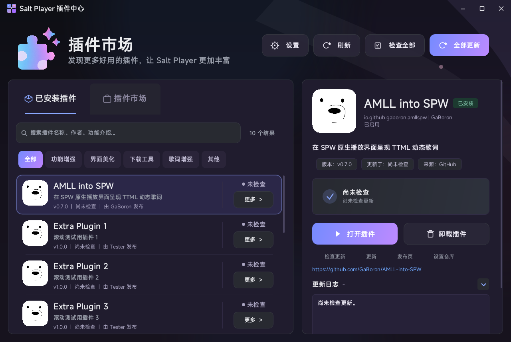
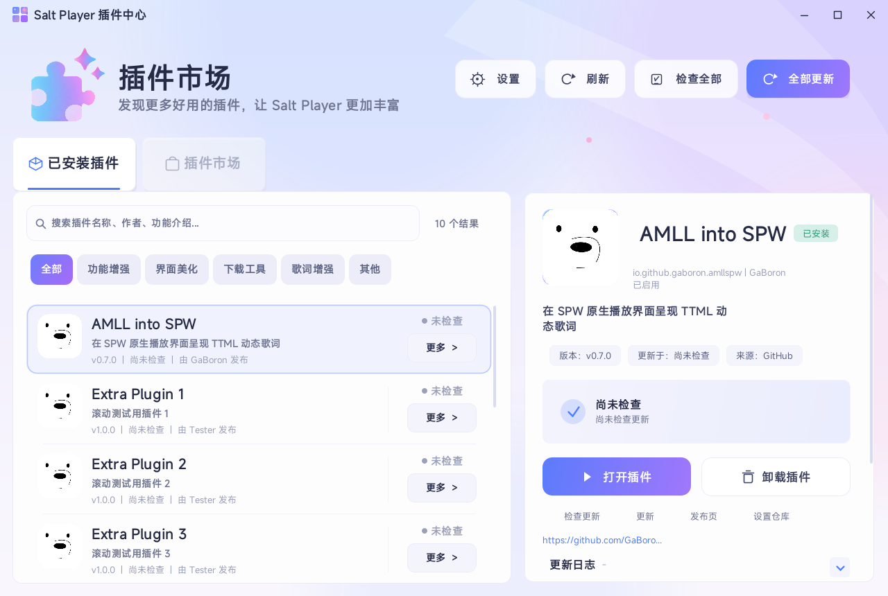
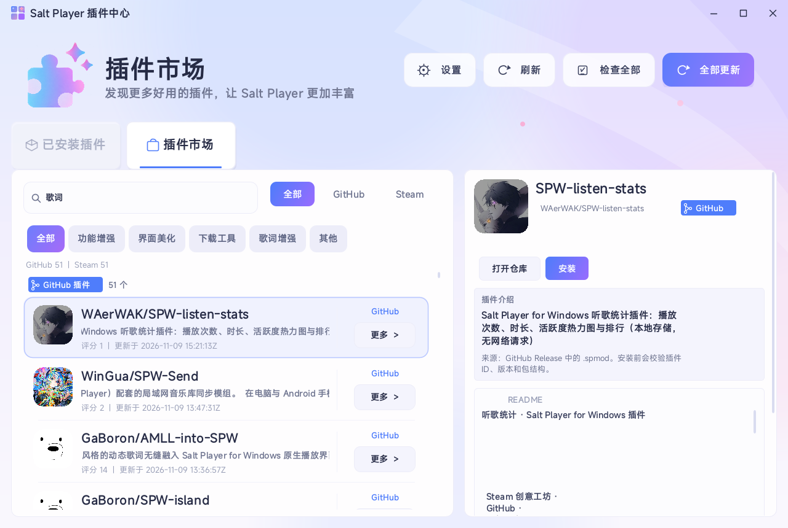

# 模组更新中心（Salt Player for Windows）

<p align="center"></p>

一个面向 **Salt Player for Windows（SPW）** 的本地插件管理工具。它会扫描 `workshop/plugins` 下的全部模组，读取每个模组清单里的 GitHub 仓库地址，检查 GitHub Releases，并提供带进度、错误码、失败原因和确认安装的一键更新流程。

> **AI 声明 / AI Disclosure**  
> 本项目的插件代码、界面、构建脚本和文档均由 AI 生成；仅使用 SPW Workshop API、PF4J 等第三方依赖。没有人工编写插件业务代码。

> **适用版本**  
> 本插件面向 **微软商店版（Microsoft Store）Salt Player for Windows**。实测环境为 **1.19.3**，Workshop API `0.1.0-dev22`。Steam 版的目录结构相同；Steam 创意工坊内容由 Steam 客户端订阅和下载，本插件只在插件市场读取公开工坊元数据并跳转，不绕过 Steam。

> **⚠️ GitHub API 限制（重要）**  
> 未登录 GitHub 的匿名 API 限额只有 **60 次/小时**，批量检查、频繁重试或连续检查多个模组时很容易触发 `403 rate limit`。  
> 建议在 **设置 → GitHub Token** 中填入只勾选 `public_repo` 的 Token；Token 只保存在本机插件数据目录，不会上传。触发限制时界面会显示 `GH-403-RATE` 和恢复时间。

| 已安装模组 | 插件市场（GitHub / Steam） |
| --- | --- |
|  |  |

## 功能

- **扫描全部已安装模组**：从 PF4J `MANIFEST.MF` 读取 `Plugin-Id`、`Plugin-Version`、`Plugin-Name`、`Plugin-Provider`、`Plugin-Open-Source-Url`。
- **GitHub Releases 检查**：读取最新正式 Release（可选包含 Pre-release），按语义化版本比较，自动选择 `.spmod` 资产。
- **缺少仓库地址时可手动补充**：在详情面板点“设置仓库”，支持 `https://github.com/作者/仓库`、`作者/仓库`、SSH 地址；映射保存在插件数据目录。
- **人类可读的下载进度**：右下角悬浮圆环实时显示百分比，悬停可看已下载/总大小与实时速度，点击即可取消下载。
- **明确的失败原因**：错误代码 + 中文原因 + 处理建议 + 可复制的技术详情。
- **下载后二次确认**：显示版本、安装包、大小、SHA-256，确认后才安装。
- **直接安装 + 关闭后安装兜底**：
  - 先尝试直接替换文件；
  - 如果文件被 Salt Player 占用，自动生成后台安装任务，等播放器退出后备份旧版、解压新版、失败自动回滚，并可自动重启。
- **安装前校验**：ZIP 完整性、路径穿越、插件 ID 与 Release 版本一致性、SHA-256（Release 提供 digest 时）。
- **自动检查**：启动时检查 / 每日检查 / 仅手动，三选一；默认启动时检查并提示。
- **插件市场**：GitHub 与 Steam 双源浏览、搜索和分类；GitHub 可直接安装/更新，Steam 只做展示并跳转到 Steam 客户端订阅；两个来源永远分组显示，不混在一起。
- **备份管理**：可以彻底关闭备份、设置保留份数，并一键清理全部历史备份。
- **Token 教程**：内置 GitHub Token 获取步骤，说明匿名 60 次/小时与 Token 限额差异。
- **顶部入口**：标题栏原生按钮（需要 `class-transform` 权限）、`Ctrl+Alt+U` 全局快捷键、配置页按钮。不提供托盘图标。
- **现代卡片 UI**：浅色/深色自适应，统一圆角、按钮、开关、输入框、对话框和来源徽章。
- **网络适配**：可填 GitHub Token（提高 API 限额）、代理；代理留空时自动使用 Windows 系统代理，填 `direct` 强制直连。
- **按需权限**：`key-bindings` 用于全局快捷键，`class-transform` 用于标题栏原生按钮；两者不可用时其余功能照常。

## 安装

1. 下载 `plugin-dev.saltupdater-1.3.0.spmod`。
2. 打开 Salt Player → **设置 → 创意工坊 → 模组管理 → 导入模组**。
3. 选择 `.spmod`，确认名称后导入。
4. 在模组操作菜单选择 **启用**；本插件不申请权限，直接启用即可。
5. 打开该模组的 **配置**，点击 **打开模组更新中心**。

> 也可以直接把 `.spmod` 放在 `workshop/plugins` 下并解压为同名目录，再把 `dev.saltupdater` 写入 `enabled.txt`。推荐仍然使用官方的“导入模组”流程。

## 使用

1. 打开更新中心后，点 **检查全部**。
2. 左侧列表会显示每个模组的当前版本、最新版本和状态：
   - `可更新`：GitHub 上有更高版本；
   - `已是最新`：版本不高于当前；
   - `未设置仓库`：清单没有 `Plugin-Open-Source-Url`，点右侧“设置仓库”补充；
   - `失败`：右侧会显示错误代码、原因和建议。
3. 选中模组，右侧可以查看 Release 说明、打开仓库/发布页/安装目录。
4. 点 **更新**，确认下载；下载完成后会再次询问 **是否确认安装**。
5. 如果直接替换失败（文件被占用），会提示“已加入安装队列”。关闭 Salt Player 后，后台助手会：
   - 备份旧 `.spmod` 和旧目录；
   - 解压新版本；
   - 失败时回滚；
   - 如果开启了“关闭后自动重启”，自动启动 Salt Player。

### 插件市场

窗口顶部有两个页签：

- **已安装模组**：检查、下载和更新本地模组。
- **插件市场**：搜索 GitHub 与 Steam 插件，按来源分组显示。

市场里：
- **GitHub 插件**：来自 GitHub topic `salt-player-plugins` 的仓库，可打开仓库或直接安装/更新；安装会读取最新 Release 的 `.spmod`。新插件安装后如果模组管理仍显示未启用，请手动启用一次；已有插件的更新会保留原启用状态。
- **Steam 创意工坊**：只展示标题、封面、简介、订阅数和更新时间，点击 **在 Steam 打开** 跳转到 Steam 页面。Steam 内容由 Steam 客户端订阅和下载，本插件不绕过 Steam。
- 来源筛选：全部 / GitHub / Steam；搜索会同时查询两个来源，但结果始终分节展示，不会混淆来源。

### 备份管理

- 设置里的 **保留安装备份** 可以完全关闭备份保留。
- **保留备份数** 控制最多保留几份；关闭备份后不再保留任何历史备份。
- **清理全部备份** 会删除已经保存的所有旧版备份，不影响当前已安装插件。
- 即使关闭备份，安装失败时仍会使用一次临时回滚目录，成功后立即删除。

### 批量更新

点 **全部更新**：先依次下载所有可更新模组，下载完成后统一确认安装。单个失败不会阻塞其他模组。

### 设置

配置页或更新中心右上角“设置”都可以调整：

| 设置 | 默认 | 说明 |
| --- | --- | --- |
| 自动检查 | 启动时检查 | 启动时检查 / 每日检查 / 仅手动 |
| 包含预发布版本 | 关 | 开启后会检查 Pre-release |
| 关闭后自动重启 | 开 | 仅对“关闭后安装”生效 |
| 启动时打开更新中心 | 关 | 启动完成后自动打开窗口 |
| 标题栏悬浮按钮 | 开 | 实验性；失败时用 `Ctrl+Alt+U` 或托盘菜单 |
| 保留安装备份 | 开 | 关闭后不保留任何历史备份 |
| 保留备份数 | 2 | 仅开启备份时生效 |
| GitHub Token | 空 | 可选；匿名 API 限额 60 次/小时 |
| 代理 | 空 | 留空自动使用 Windows 系统代理；填 `direct` 强制直连 |

Token 教程在设置里的 **如何获取**，或配置页的 **如何获取 GitHub Token**。匿名 API 限额为 **60 次/小时**，填 Token 后为 **5000 次/小时**。

## 错误代码

| 代码 | 含义 / 处理 |
| --- | --- |
| `NET-DNS` | 无法解析 GitHub 域名；检查 DNS 或代理 |
| `NET-CONNECT` | 无法连接 GitHub；检查网络/代理端口 |
| `NET-TIMEOUT` | 连接超时；稍后重试或换代理 |
| `NET-TLS` | TLS 握手失败；检查系统时间、证书替换软件、代理 HTTPS 支持 |
| `GH-401` | Token 无效或过期；重新生成 Token |
| `GH-403` | GitHub 拒绝请求；私有仓库需要 Token，或网络被限制 |
| `GH-403-RATE` | API 限额用完；填 Token 或等到提示的恢复时间 |
| `GH-404` | 仓库/Release 不存在；检查仓库地址、是否公开 |
| `GH-NO-RELEASE` | 没有可比较的 Release；确认作者发了 Release 且标签是版本号 |
| `GH-ASSET-MISSING` | Release 没有 `.spmod` 资产；打开发布页手动下载 |
| `GH-SEARCH` | GitHub 市场搜索返回异常；稍后重试 |
| `STEAM-403` | Steam 暂时拒绝请求；稍后重试或打开浏览器 |
| `STEAM-404` | Steam 工坊页面不存在 |
| `STEAM-JSON` | Steam 详情数据解析失败 |
| `STEAM-IO` | 读取 Steam 工坊失败；检查网络/代理 |
| `MARKET-SEARCH` | 市场搜索失败；检查网络或 GitHub API 限额 |
| `MARKET-INSTALL` | 从市场安装失败；查看日志和 Release 资产 |
| `REPO-INVALID` | 仓库地址格式无法识别 |
| `VER-INVALID` | 当前版本或标签不是可比较的版本号 |
| `DL-404` | 下载地址失效；重新检查或打开发布页 |
| `DL-403` | 下载被 GitHub 拒绝；私有仓库填 Token 或稍后重试 |
| `DL-5XX` | GitHub 下载服务器临时故障；稍后重试 |
| `DL-DISK` | 磁盘空间不足 |
| `DL-SIZE` | 下载大小与 Release 不一致 |
| `DL-HASH` | SHA-256 校验不匹配；重试并核对发布页 |
| `DL-CANCELLED` | 用户取消下载 |
| `PKG-ZIP` | ZIP 损坏或不完整 |
| `PKG-PATH` | 安装包包含路径穿越/绝对路径，已拒绝 |
| `PKG-ID-MISMATCH` | 包内插件 ID 与当前模组不一致，可能选错资产 |
| `PKG-VERSION-MISMATCH` | 包内版本与 Release 不一致 |
| `INS-LOCKED` | 文件被 Salt Player 占用；使用关闭后安装 |
| `INS-DEFER` | 无法创建后台安装任务；检查数据目录权限 |
| `INS-FAILED` | 直接安装失败；查看日志 |

日志位置：`workshop/data/dev.saltupdater/logs/updater.log`（在更新中心点“打开日志”即可）。

## 从源码构建

要求：

- JDK 25 或更高（构建脚本默认找 `JAVA_HOME`，其次 `D:\JDK26`）。
- 本仓库 `tools/` 下的编译依赖：
  - `spw-api.jar`（SPW Workshop API `0.1.0-dev22`，Apache-2.0）
  - `pf4j-3.12.0.jar`（Apache-2.0）
  - `jna-5.17.0.jar`（Apache-2.0，用于实验性标题栏悬浮按钮）

Windows：

```powershell
Set-ExecutionPolicy -Scope Process Bypass
.\build.ps1
```

产物：

```
build/libs/plugin-dev.saltupdater-1.1.0.spmod
```

`build.ps1` 只做三件事：`javac --release 25` 编译、复制资源、用 `tools/Build.java` 生成 `.spmod`。插件运行时只依赖 `java.base` + `java.desktop`，不打包任何第三方运行时库。

### 测试

```powershell
# 核心单元/集成测试：版本、JSON、仓库解析、扫描、包校验、直接安装
java -cp "build/test-classes;build/classes;tools/spw-api.jar;tools/pf4j-3.12.0.jar;tools/kotlin-stdlib-2.4.20.jar" SelfTest

# 真实 GitHub Release 探测（需要网络）
java -cp "build/test-classes;build/classes;tools/spw-api.jar;tools/pf4j-3.12.0.jar;tools/kotlin-stdlib-2.4.20.jar" LiveProbe

# 真实下载 + SHA-256 + 解压 + 直接安装
java -cp "build/test-classes;build/classes;tools/spw-api.jar;tools/pf4j-3.12.0.jar;tools/kotlin-stdlib-2.4.20.jar" LiveDownloadTest

# 关闭后安装 PowerShell 助手
java -cp "build/test-classes;build/classes;tools/spw-api.jar;tools/pf4j-3.12.0.jar;tools/kotlin-stdlib-2.4.20.jar" DeferredTest
```

## 目录结构

```
src/main/java/dev/saltupdater/
  MainPlugin.java             插件入口、生命周期、自动检查
  ConfigActions.java          配置页按钮入口
  core/
    AppPaths.java             逻辑/物理 workshop 路径（MSIX 兼容）
    ModScanner.java           扫描模组清单与 .spmod
    Version.java              宽松语义化版本比较
    GitHubClient.java         GitHub Releases / 资产选择 / 错误映射
    Downloader.java           流式下载、进度、取消、SHA-256
    PackageValidator.java     ZIP 安全校验与解压
    InstallService.java       直接安装、备份、回滚、关闭后安装
    UpdateService.java        检查/下载/安装编排、市场安装
    SteamWorkshopClient.java  Steam 创意工坊浏览/搜索/详情（只读）
    ProxySupport.java         设置代理 + Windows 系统代理自动检测
    Json.java                 无第三方依赖的 JSON 读写
  ui/
    UpdateCenterWindow.java   更新中心窗口、页签、批量更新与各类对话框
    MarketPanel.java          GitHub + Steam 双源插件市场
    InstalledListPanel.java   已安装列表：搜索、分类、选中
    PluginDetailPanel.java    右侧详情卡：版本、状态条、操作、更新日志
    DownloadFloat.java        右下角悬浮下载指示器（进度环 + 点击取消）
    PluginRowPanel.java       101px 列表行
    HeroPanel.java            顶部 Hero：标题、副标题、动作按钮、页签
    BackdropPanel.java        背景渐变、柔光斑与绸带
    TabStrip.java             页签条与激活下划线
    PillButton.java           56px 胶囊动作按钮
    DetailButton.java         56px 详情主/次按钮
    SearchBar.java            52px 搜索框与结果计数
    FilterChip.java           44px 分类 chip
    Theme.java                颜色、字体与设计令牌（浅色/深色）
    Icons.java                线性矢量图标
    ImageCache.java           市场封面异步加载
    WindowTitleBar.java       无边框窗口标题栏
```

## 安全与隐私

- 插件在 Salt Player 进程内运行；Workshop 权限机制不是 OS 沙箱。本插件不申请任何宿主权限。
- 只读取 `workshop/plugins` 下的清单和 `.spmod` 元数据；只写入插件自己的数据目录和用户在界面中确认的模组文件。
- 网络请求只发给 `api.github.com`、`github.com` 和 GitHub Release 资产域名；不会上传本地曲库、模组列表或 Token。
- Token 只保存在本机 `workshop/data/dev.saltupdater/config.json`，请勿把该文件分享给他人。
- 安装前会校验 ZIP 路径、插件 ID、版本和可用的 SHA-256；最终安装仍需用户确认。
- “关闭后安装”使用插件数据目录中的 PowerShell 脚本，只处理该目录下的任务文件；脚本会等待 Salt Player 退出，失败自动回滚。

## 已知限制

- 只支持 GitHub Releases 中的 `.spmod` 资产；没有 `.spmod` 的 Release 会提示手动下载。暂不支持 `.zip` / 源码包。
- GitHub 标签需要是可比较的版本号（`v1.2.3`、`1.2.3.4` 等）；纯日期标签也可以，但 `nightly` 这类标签无法比较。
- Steam 创意工坊在市场中只做浏览、搜索和跳转；Steam 内容必须由 Steam 客户端在“拥有 SPW + 已订阅”的前提下下载，本插件不绕过 Steam 的授权与下载机制。
- 实验性标题栏悬浮按钮通过独立顶层窗口实现，不会修改宿主 Compose UI；如果它被宿主窗口覆盖或位置不合适，可在设置中关闭，改用 `Ctrl+Alt+U` 或托盘菜单。
- 市场 GitHub 搜索也受 GitHub API 限额影响；搜索过多时请填写 Token。
- 直接替换文件时，已经加载的插件类不会在运行中的 JVM 里重新加载；如果播放器仍显示旧版本，重启后生效。文件被占用时会自动转为关闭后安装。
- 匿名 GitHub API 限额为 60 次/小时；批量检查较多模组时建议填写 Token。
- 本插件自身的仓库是 <https://github.com/KylinZhangQAQ/SaltPlayer-Mod-Updater>，因此它也可以参与自更新；但正在运行的插件文件可能被占用，更新自身时通常会走“关闭后安装”。

## 许可

本插件代码使用 MIT License。SPW Workshop API 与 PF4J 的许可信息见 `tools/` 中对应依赖及上游仓库。

